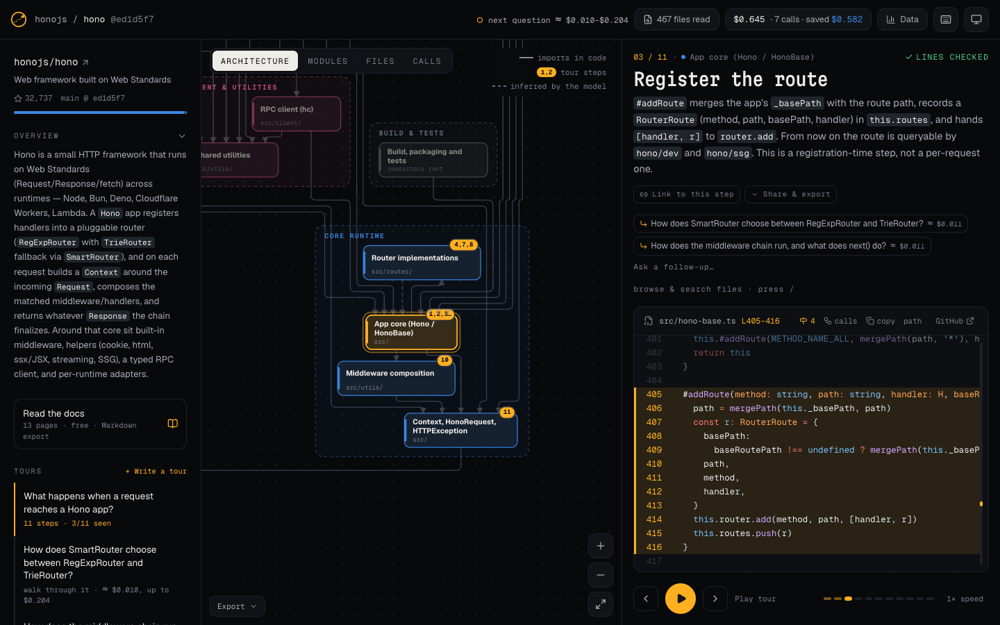
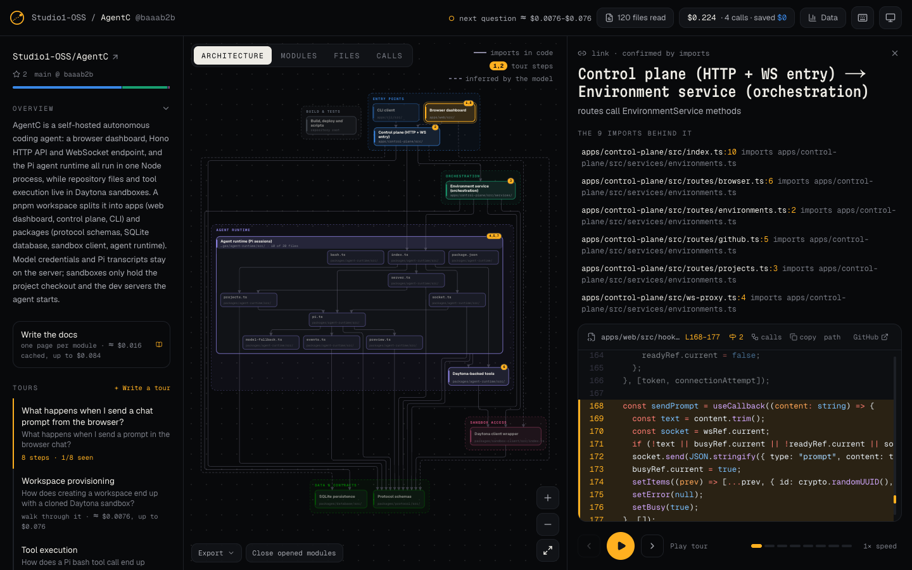
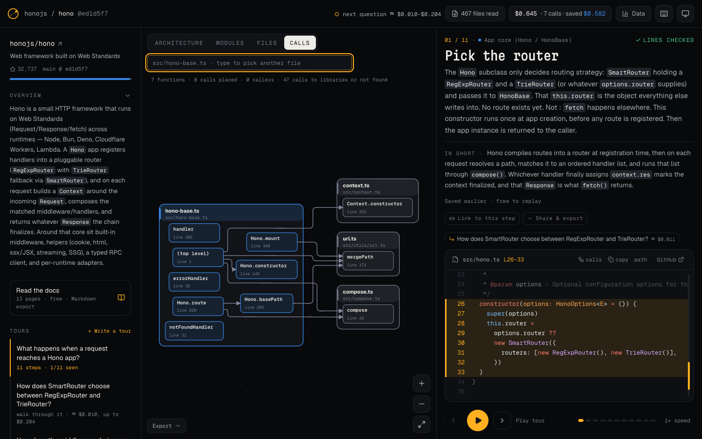
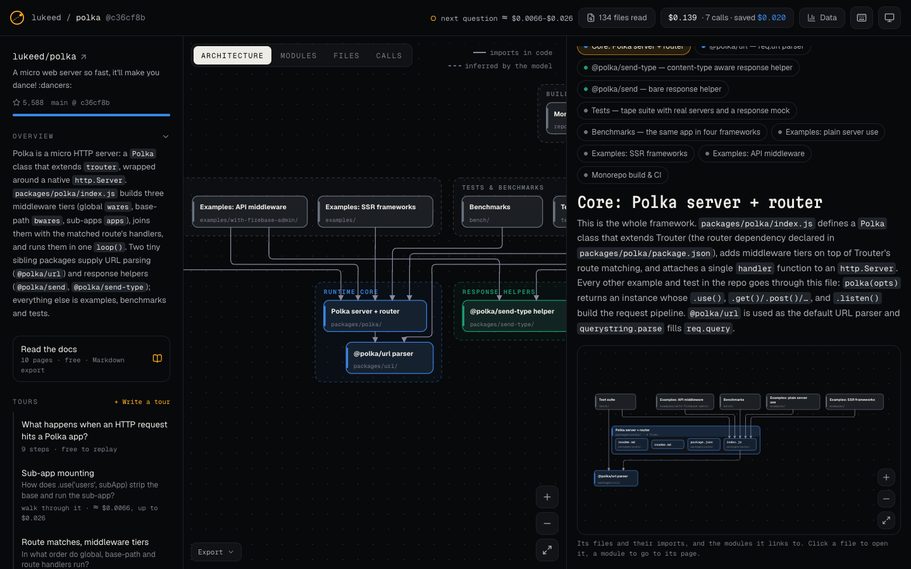
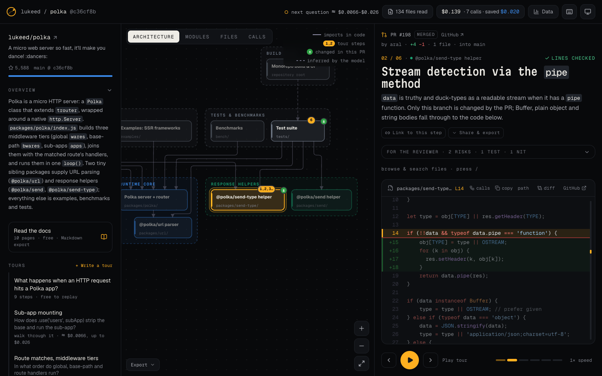
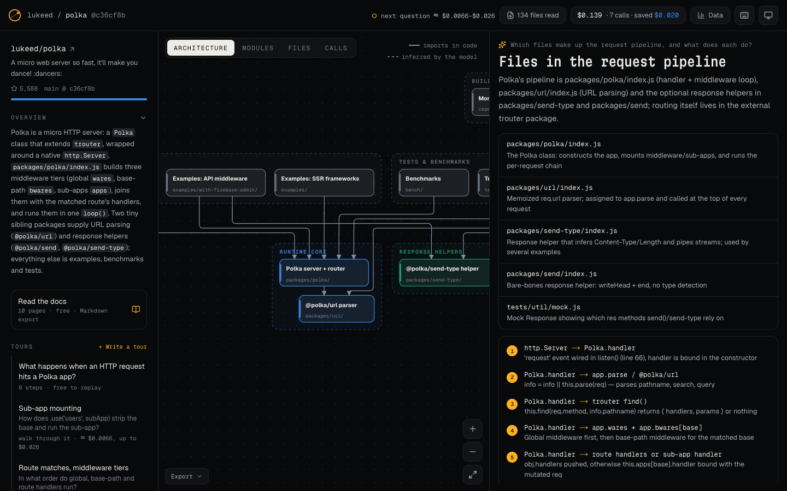

<p align="center"></p>

<h1 align="center">Codetrail</h1>

<p align="center"><b>Understand any codebase in one read.</b><br>A map, guided tours, docs and answers for a GitHub repo, a pull request or a folder on your machine. Every line it points to is checked against the code.</p>

<p align="center">

<a href="https://tokenfactory.nebius.com/?modals=endpoint-details&model-id=deepseek-ai/DeepSeek-V4.1-Flash-1017"></a>
<a href="https://dub.sh/aistudio"></a>

<a href="./LICENSE"></a>
<a href="https://studio1hq.com"></a>
</p>

<p align="center"><a href="#run-it">Run it</a> · <a href="docs/user-guide.md">User guide</a> · <a href="#what-you-get">What you get</a> · <a href="#how-it-compares">How it compares</a> · <a href="#how-codetrail-uses-deepseek-v41-flash-1017">How it works</a> · <a href="#what-it-costs-measured-october-2026">What it costs</a></p>



Getting to know a new codebase usually means hours of clicking through files. Codetrail hands the whole repo to **[DeepSeek V4.1 Flash 1017](https://tokenfactory.nebius.com/?modals=endpoint-details&model-id=deepseek-ai/DeepSeek-V4.1-Flash-1017)** in one prompt. With a 1M-token context there's no search index guessing which pieces matter: the model sees every file. It draws the map of modules, walks you through how the code actually runs, step by step, and answers your questions. Each step quotes a real line of code, and Codetrail finds that line in the file before showing it.

It's open source and runs on your own [Nebius Token Factory](https://dub.sh/aistudio) key. A small repo costs 1–3 cents to read, and everything it writes is saved, so the next visit is free.

## What you get

- **The whole repo, one prompt.** The model has a 1,048,576-token context, so files go in whole with line numbers. There's no search index choosing chunks, so a flow that crosses ten files stays whole.
- **Every step is checked.** Each step quotes one line of code. Codetrail finds that line in the real file at that commit and moves the range if the model's line numbers drifted. Steps it can't find are dropped, never shown. Map links backed by real imports are marked.
- **An architecture diagram.** The modules are drawn top to bottom in the order calls flow, grouped into layers and coloured, with links confirmed by imports drawn solid. Double-click a module to open it into its files; click a link to see the import lines behind it. The Modules view shows the same map as a graph you can drag, and the Files view is the real import graph. Tours light up their route on every view. Export it as Mermaid (layers, colours and GitHub links included), SVG, PNG or an editable draw.io file, or embed a live image and badge in your README.
- **Function calls.** The Calls view shows one file's functions, what each calls and who calls them, worked out from the code: JavaScript and TypeScript with the TypeScript compiler, Python and Go by name through their imports.
- **Ask anything.** One Ask box picks a tour or a short structured answer from your wording (generative UI: tables, file lists, call sequences, checked code references), or Thorough for harder questions. While you type, it shows anything already stored that answers the question, free.
- **Follow-ups.** Every answer and repo tour suggests what to ask next and takes follow-up questions with a recap of the conversation. Conversations get their own link and replay free.
- **Written docs.** One call writes a page for every module (overview, how it works, key files, where to look), every reference checked, each with a diagram of the module's files and neighbours. Export a page or all of them as Markdown (diagrams as Mermaid) or JSON; answers export as Markdown too.
- **Pull-request tours.** Paste a PR link (or `/owner/repo/pull/123`). DeepSeek already has the repo, so it gets only the change and walks through it in the order it runs. Changed lines are marked in the code, the diff is one click away, and notes for the reviewer (risks, missing tests, questions) each point at a checked line.
- **Tours you can write.** Write your own tour, or edit a copy of a generated one: pick lines of code and say what they do; every step is checked against the code when you save. Wherever a tour stops, a mark sits in the code's margin and opens it there, like CodeTour's markers. Your progress through each tour is ticked off, and the last step offers the next one.
- **Every file, searchable.** After the first read, the whole commit lives in SQLite with a full-text index: browse and search every file, copy code or a `path:lines` reference, and open GitHub file links (`/owner/repo/blob/<ref>/<path>#L10`) right in the app.
- **Only the folders you want.** For a big monorepo, choose which folders to read (or skip) before you pay; the estimate follows as you choose, and the scoped read is stored apart from the full one.
- **The receipt for every call.** Live prices, the price before every paid click, and fresh vs cached tokens, output, time and what cached input saved, on every call. A **Stop** button ends any call you no longer want; when no one else is waiting on it, DeepSeek stops writing.
- **Share it.** Every tour step, answer, conversation, docs page and open file has its own link, and Back and Forward move between them. Tours get a share card image (route, stats, where each step sits in its file) that shows up as the link preview, and export to VS Code CodeTour.
- **For AI tools.** Every read repo has a Markdown page at `/owner/repo.md` (architecture as Mermaid, modules, tours, docs and answers) and `/llms.txt` lists them, all from stored data. **Browse** lists every repo read on your instance.
- **Inside your coding agent.** Codetrail is an MCP server, so Claude Code, Cursor and other agents can call it as a tool. Before touching unfamiliar code, an agent can ask for the map, a tour or an answer with exact `file:line` references instead of grepping its way around, and `codetrail_pr` hands it a reviewer's walkthrough of a pull request. Works for GitHub repos and your local folders. [Set it up](docs/user-guide.md#13-coding-agents-mcp).
- **Your own code, on your machine.** Run it in one Docker container with your Nebius key and point it at a folder of projects: work that isn't on GitHub yet, or isn't pushed, gets the same map, tours, docs and answers, uncommitted changes included. It all stays in your own database. Private GitHub repos work too, with a token. [How](docs/user-guide.md#10-your-own-folders).

<table>
<tr>
<td width="33%"></td>
<td width="33%"></td>
<td width="33%"></td>
</tr>
<tr>
<td align="center"><sub>A module opened into its files, and the imports behind a link</sub></td>
<td align="center"><sub>Function calls, worked out from the code</sub></td>
<td align="center"><sub>Docs with a diagram on every page</sub></td>
</tr>
<tr>
<td width="33%"></td>
<td width="33%"></td>
<td width="33%"></td>
</tr>
<tr>
<td align="center"><sub>A pull request, changes marked</sub></td>
<td align="center"><sub>An answer with checked references</sub></td>
<td align="center"><sub>What a read will send and cost, before you pay</sub></td>
</tr>
</table>

## How it compares

Codetrail does the jobs of four tools people use to understand a codebase. GitDiagram draws a repo's architecture, DeepWiki writes a wiki and answers questions, CodeTour plays hand-written walkthroughs in VS Code, and CodeViz draws architecture and call graphs in VS Code.

| | Codetrail | GitDiagram | DeepWiki | CodeTour | CodeViz |
|---|---|---|---|---|---|
| What the model sees | Every file, one prompt | Tree, README, source excerpts | An index of the repo, searched per page and question | No model | AI agents search the code |
| Architecture diagram | Layers, colours, routed links; open a module into its files | Layers, colours, links | Mermaid diagrams in wiki pages | — | C4 and UML, editable |
| Written docs for every module | Yes, references checked, a diagram per page | A short overview | Yes, a wiki | — | Diagram-led docs |
| Ask questions about the code | Yes, with follow-ups and a Thorough mode | — | Yes, with Deep Research | — | Yes |
| Step-by-step walkthroughs with file + line | Generated or written by you, every line checked | — | Codemaps (code in execution order) | Hand-written | Walkthroughs in search results |
| Tour markers in the code, progress | Yes | — | — | Yes | — |
| Pull requests | A tour of the change, with review notes | — | — | Tours pinned to a branch or commit | PR diagrams (paid plan) |
| Checked against the code | Every quoted line | Every linked path | — | Drift warnings in CI | — |
| Export the diagram | Mermaid (with GitHub links), SVG, PNG, draw.io | Mermaid, PNG | — | `.tour` files | Mermaid, draw.io, PNG, SVG |
| A live diagram image for a README | Yes, with a badge | Yes, with a badge | A badge | — | Embeds (Teams plan) |
| Markdown page for AI tools | `/owner/repo.md`, `llms.txt` | `/owner/repo.md`, `llms.txt` | — | — | — |
| Read only some folders | Choose folders or globs | — | A page list in `.devin/wiki.json` | — | — |
| What it costs you | Your Nebius key; the price shown before and after every call | Free quota, cost after a run | Free for public repos | Free | Free tier, Pro $19/month |
| Works from a URL in the browser | Yes | Yes | Yes | VS Code (desktop and web) | VS Code |
| MCP server for coding agents | Yes | Yes | Yes | — | — |
| Open source | Yes, MIT | Yes, MIT | No | Yes, MIT | No |
| Private code | Self-hosted; code goes only to your Nebius endpoint | With a GitHub token | With a Devin account | Local files | Local folders; code goes to cloud models |
| Function-level call graph | JS/TS, Python, Go, from the code | — | — | — | Yes, from the language server |
| Explainer video of a repo | — | Yes | — | — | — |

Checked in October 2026 against each tool's own docs and code. Where the others are ahead: CodeViz draws editable C4 and UML diagrams and covers more languages in its call graph; GitDiagram makes narrated explainer videos; DeepWiki already has wikis for many public repos, so there's nothing to wait for; CodeTour plays tours inside VS Code itself.

## How Codetrail uses DeepSeek V4.1 Flash 1017

Every model call sends the **same prefix**: a system prompt, a repo header (GitHub facts, languages, a summary of the import graph, up to six diagram images), then **every file with numbered lines**. Only the last message changes.

1. **First read: one call, map + main tour.** DeepSeek writes a summary, groups files into 4–14 modules and 3–6 architecture layers, draws how they connect, proposes the questions worth asking, and writes the first tour (4–12 steps, each with a file, a line range, an exact quoted anchor line and a short narration). It streams, so the map builds live on screen.
2. **Every extra tour or question.** Same prefix plus the question (and, for a follow-up, a recap of the conversation: the last 6 turns as question plus a short gist, capped at ~10K tokens). Tours come back as strict JSON; answers come back as OpenUI Lang using Codetrail's own block library. Because the prefix is identical, the repo can be billed as **cached input** ($0.006 per 1M tokens instead of $0.30).
3. **Pull requests.** Same prefix, then the PR: its description, the changed-files list, the patches (most useful files first, up to ~120K tokens) and the PR's version of each changed file with line numbers (up to 40 files). Steps and review notes are checked against the code as the PR leaves it. Stored per head commit, so a new push gets a new tour and old ones stay.
4. **Images.** Architecture diagrams in a repo's README or docs go in as image input.

**Code, not the model, does:** download and filtering, secret scanning, the import graph and entry points, line numbers, token estimates, checking every step and code reference against the real file, marking import-backed links, pricing, storage and rendering.

**Settings:** strict JSON-schema output (JSON mode as a fallback), `reasoning_effort: medium`, and one repair turn only when an answer is invalid or loses more than 30% of its steps. A repair resends the whole repo, so it's rare by design.

### What it costs (measured, October 2026)

Nebius Token Factory prices for `deepseek-ai/DeepSeek-V4.1-Flash-1017`: $0.30 / 1M input, **$0.006 / 1M cached input**, $1.20 / 1M output.

| Repo | Tokens read | Measured |
|---|---|---|
| lukeed/polka | 68K | Map + main tour in one call: **$0.028**, 16 s. A generative-UI answer: $0.022, 5.9 s |
| pmndrs/zustand | 251K | Extra tour with the repo cached: **$0.005**, 99% of input from cache |
| sindresorhus/ky | 437K | Whole-repo read: $0.134, 16 s |
| lukeed/polka, PR #210 | 71K | Pull-request tour with the repo cached: **$0.007**, 95% from cache (PR #198, cache missed: $0.023) |

The prompt cache is best-effort ([Token Factory's caching docs](https://docs.tokenfactory.nebius.com/cached-tokens)): a call can land on a server that doesn't hold the repo yet, and an unused prefix can be dropped after a few minutes. In our runs, 6 of 13 follow-up calls were served from it. Every call shows its real cached share, the Ask box shows both prices before you ask, and stored tours, answers and conversations replay free.

## Tech stack

| Layer | Choice |
|---|---|
| Model | DeepSeek V4.1 Flash 1017 on Nebius Token Factory (OpenAI-compatible API, `openai` SDK, streaming) |
| Agent framework / RAG | None. One call per job on the cached repo (strict JSON or OpenUI Lang), then checks in code; no embeddings or vector DB |
| Generative UI | [OpenUI](https://github.com/thesysdev/openui) (MIT) for Ask answers, from Codetrail's own component library |
| App | Next.js 16, React 19, Tailwind CSS 4, zod 4 |
| Diagrams and graphs | [ELK](https://github.com/kieler/elkjs) layered layout for the architecture, docs and call diagrams (in the browser, and on the server for README images); d3-force, d3-zoom, d3-drag, d3-hierarchy |
| Call graph | The TypeScript compiler's parser for JS/TS; line-based parsing for Python and Go |
| Code | shiki |
| Repo ingest | GitHub REST + one codeload tarball (or a local folder), an import-graph parser (JS/TS incl. tsconfig paths and workspaces, Python, Go, Rust, Java/Kotlin, C/C++, Ruby), [Secretlint](https://github.com/secretlint/secretlint) for secrets, signatures-only compression for files over budget |
| Storage | SQLite via libsql + drizzle: every file of every commit read (FTS5 full-text search), maps, tours, answers, docs, the cost ledger, stats, quotas and accounts. A local file, or Turso when hosted |
| Auth | Better Auth with GitHub (hosted mode only) |
| Share images | `next/og` |
| Agents | `@modelcontextprotocol/sdk` (stdio + Streamable HTTP) |
| Running it | Docker (Next.js standalone), or Node 22 + pnpm |

**Credits.** Ideas we learned from: the URL swap and MCP endpoints of GitDiagram and DeepWiki; fixing line numbers from a quoted snippet, as in deepwiki-open; the step model of CodeTour; the file-level graph of CodeViz; secret scanning and compression from Repomix.

## Run it

All it needs is a [Nebius Token Factory](https://dub.sh/aistudio) API key. There's no vector database, embeddings model or indexing job to set up: the model's 1M-token context takes a whole repo in one prompt, so Codetrail is one app and one SQLite file.

### With Docker (no Node.js needed)

[Docker](https://www.docker.com/products/docker-desktop) packages Codetrail with everything it needs (Node.js, its dependencies, the built app) into one image, so you don't install anything else. Build the image once, then run it whenever you want:

```bash
git clone https://github.com/Studio1-OSS/Codetrail.git
cd Codetrail
docker build -t codetrail .

docker run --name codetrail -p 3000:3000 \
  -e NEBIUS_API_KEY=your-key \
  -v codetrail-data:/data \
  -v ~/code:/repos:ro \
  codetrail
```

Then open **http://localhost:3000**. What each part does:

| Part | What it's for |
| --- | --- |
| `-p 3000:3000` | Opens the app at localhost:3000 |
| `-e NEBIUS_API_KEY=…` | Your key, used for the model calls. Add `-e GITHUB_TOKEN=…` for private GitHub repos and GitHub's higher rate limit |
| `-v codetrail-data:/data` | A Docker volume that keeps the database (repos read, tours, answers, costs) when the container stops or you update it |
| `-v ~/code:/repos:ro` | Optional. Shares a folder of your projects, read-only. Each folder inside it appears under **Your folders** on the home page, uncommitted changes included |

New to Codetrail? The **[user guide](docs/user-guide.md)** walks through every part of the app, from the first read to pull requests and MCP.

Stop it with `docker stop codetrail` and start it again with `docker start codetrail`. To update: `git pull`, `docker build -t codetrail .`, `docker rm codetrail`, then the same `docker run`. The volume keeps your data.

### From source

Use Node.js 22.13+ and pnpm:

```bash
git clone https://github.com/Studio1-OSS/Codetrail.git
cd Codetrail
pnpm install
cp .env.example .env      # add NEBIUS_API_KEY
pnpm dev                  # http://localhost:3000
```

Nobody signs in by default (`AUTH_MODE=none`) and there are no limits: no quotas, no rate limit, no spend cap unless you set `DAILY_BUDGET_USD`. The database migrates itself on first use. Set `GITHUB_TOKEN` to lift GitHub's own limit of 60 API requests an hour.

**Local folders.** Set `LOCAL_ROOT` to a folder (say `~/code`) and every folder inside it can be opened at `/_local/<folder>`, and is listed on the home page. They're read from disk with the same filters and secret scan as a GitHub repo. A folder's "commit" is a fingerprint of its files, so after you edit something, the next visit offers a fresh read, while an unchanged folder replays free. Local folders are never available when `AUTH_MODE=github`.

**Private repos.** Self-hosted, Codetrail opens any private repo your `GITHUB_TOKEN` can read (a fine-grained token with "Contents: read" on those repos is enough). Its files, maps, tours and docs stay in your own database; the only thing that leaves your machine is the model call to Nebius Token Factory. Token Factory's prompt cache keeps derived model state, not your code, and only a request that starts with exactly the same content can reuse it ([their caching docs](https://docs.tokenfactory.nebius.com/cached-tokens)). The hosted app (`AUTH_MODE=github`) stays public-only, because stored tours there are open to every visitor.

### Hosted mode (sign-in and free quotas)

Set `AUTH_MODE=github`, `BETTER_AUTH_SECRET` (any long random string), `BETTER_AUTH_URL` (your site's URL) and a GitHub OAuth app's `GITHUB_CLIENT_ID` and `GITHUB_CLIENT_SECRET` (callback: `<your site>/api/auth/callback/github`). Anyone can open stored repos, tours and answers. Reading a new repo or asking needs sign-in, with `QUOTA_READS_PER_DAY` and `QUOTA_ASKS_PER_DAY` per account; set `DAILY_BUDGET_USD` to cap total spend. For Vercel, point `DATABASE_URL` and `DATABASE_AUTH_TOKEN` at a Turso database.

### MCP

```bash
# With the app running (Docker, pnpm dev, or your own deployment)
claude mcp add --transport http codetrail http://localhost:3000/api/mcp
# Without the app running, from the source folder
claude mcp add codetrail -- pnpm --dir /path/to/Codetrail -s mcp
```

Setup for Cursor and examples are in the [user guide](docs/user-guide.md#13-coding-agents-mcp).

| Tool | |
|---|---|
| `codetrail_map(repo)` | Summary, modules with their layers and key files, connections (confirmed by imports or inferred), the architecture as Mermaid, suggested tours |
| `codetrail_ask(repo, question, thread?, thorough?)` | A short answer with checked code references and questions to ask next. Returns a thread id; pass it back to follow up in context |
| `codetrail_tour(repo, question)` | Ordered steps with `path:Lx-Ly`, a GitHub link at the exact commit, and an explanation per step |
| `codetrail_pr(repo, number)` | A reviewer's tour of a pull request: what it changes, steps through the PR's code, and review notes tied to checked lines. `repo` can be the PR's URL |

### Scripts

```bash
pnpm test                                   # unit tests
pnpm tsx scripts/inspect.mts owner/repo     # what would be read and what it would cost, no AI call
pnpm eval owner/repo [...]                  # map + first tour per repo, with cost and checks (costs money)
pnpm smoke:nebius                           # model, context and price straight from Token Factory
pnpm tsx scripts/check-gating.mts           # hosted sign-in and quota checks, no AI call
```

## Accessibility

Keyboard first: Tab through the map (Enter opens a module), ←/→ step through a tour, space plays or pauses, `/` searches files, `T` reads the tour as text (with the code, copyable as Markdown), `?` lists every shortcut, Esc closes whatever is open. Shortcuts never fire while you type or on a focused button that uses the key itself. Dialogs and drawers keep focus inside and return it on close. The current step is announced to screen readers, the map has a text alternative listing every module and its links, focus is always visible, colours were checked for colour-blind separation, and animations stop under reduced motion. On a phone, the tours, Ask box and docs open in a drawer, and the map scrolls with the page (two fingers to zoom it). Day and night themes follow your system or the toggle.

## Contributing

Issues and pull requests are welcome. Run `pnpm test && pnpm typecheck && pnpm lint:dead` before sending one. Changes to prompts or checks should come with a `pnpm eval owner/repo` run on a small repo (it calls the model, so it costs a few cents).

## License

[MIT](LICENSE) © 2026 Studio1HQ
